# GitHub MCP Server with GitHub Copilot

## Hands-On Practice

**Estimated Duration:** 30–35 minutes  
**Team Size:** 2–3 participants  
**Level:** Beginner  
**Environment:** Visual Studio Code + GitHub Copilot + GitHub MCP Server

## Practice Objectives

By the end of this practice, participants will be able to:

- Understand the basic purpose of MCP.
- Explain how GitHub Copilot interacts with an MCP Server.
- Install and activate the GitHub MCP Server in Visual Studio Code.
- Identify tools exposed by the GitHub MCP Server.
- Use GitHub Copilot to retrieve information from a GitHub repository through MCP.
- Use natural-language prompts to interact with GitHub resources.

> **Practice scope:** The goal is not to explore every GitHub MCP capability. The goal is to demonstrate a simple end-to-end MCP interaction.

## Team Collaboration Rule

Participants must work in **groups of 2–3 people**. Only one participant will operate and share the computer during the practice.

### Driver

One participant will be the **Driver**. The Driver must:

- Share the Driver's screen with the group.
- Perform all installations and configurations.
- Enter commands and prompts.
- Interact with Visual Studio Code and GitHub.

### Navigators

The remaining participants will be the **Navigators**. Navigators must:

- Read the instructions.
- Guide the Driver through each step.
- Explain what needs to be done next.
- Verify that each step has been completed correctly.
- Help troubleshoot simple problems if necessary.

> **Universal Rule:** Only the Driver operates the computer. The Navigators guide the Driver through the practice.

## Requirements

**Estimated time: 5 minutes**

Before starting the practice, verify the following requirements.

### 1. GitHub Account

If the Driver does not already have a GitHub account, create one at [GitHub Sign Up](https://github.com/signup).

> **Very important:** Do not use a personal email address when creating the account. Use your official Apex email address.

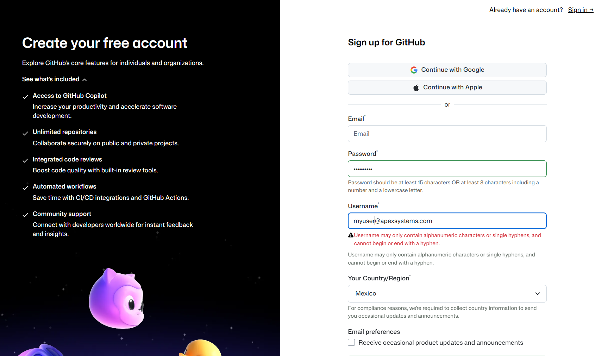

### 2. Visual Studio Code

**Visual Studio Code is required.**

> ⚠️ **Important:** Visual Studio Code and Microsoft Visual Studio are different products. Having Microsoft Visual Studio installed does not mean Visual Studio Code is installed.

Download Visual Studio Code from [Visual Studio Code Download](https://code.visualstudio.com/Download).

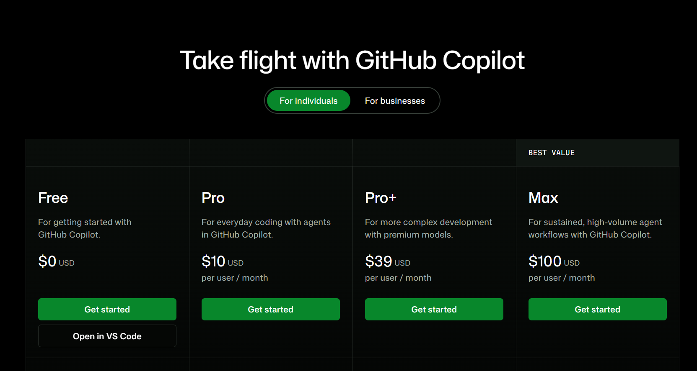

After installing Visual Studio Code:

- Open Visual Studio Code.
- Sign in to GitHub if requested.
- Verify that GitHub Copilot is available.

### 3. GitHub Copilot

After signing in to the GitHub account, open the [GitHub Copilot Plans](https://github.com/features/copilot/plans) page. Under the **Free** plan, select **Open in VS Code**.

> **Important:** Choose the **Free** plan. Do not select a paid plan for this practice.

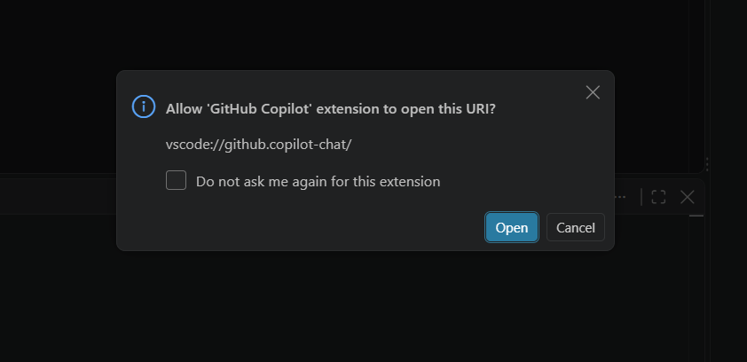

If the browser asks for permission to open Visual Studio Code, select **Open**.

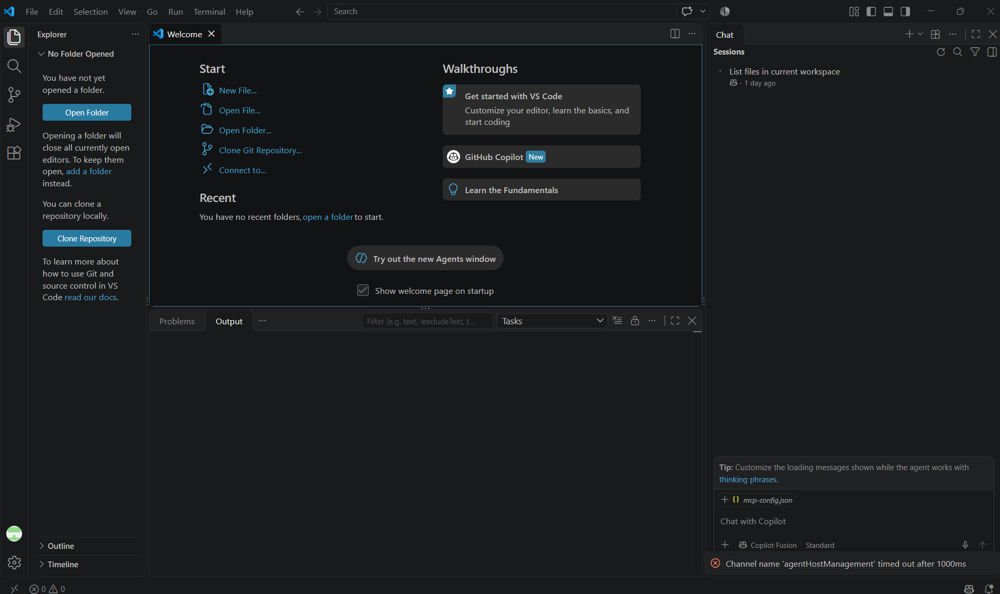

---

## Part 1: Install the GitHub MCP Server

**Estimated time: 8 minutes**

### Step 1: Open Visual Studio Code

Launch **Visual Studio Code** and verify that GitHub Copilot is available.

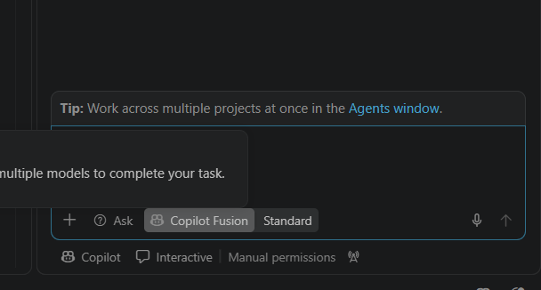

### Step 2: Open Customizations

Press **Ctrl + Shift + P**, search for **Chat: Open Customizations**, open the command, and select **Browse**.

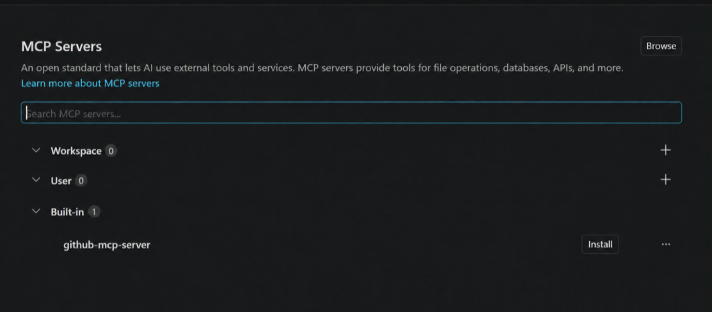

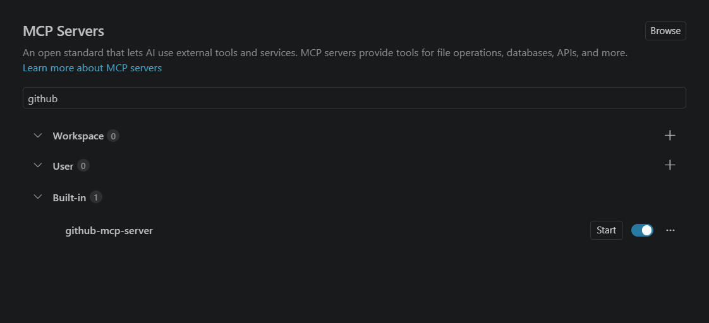

### Step 3: Find the GitHub MCP Server

1. In **Browse Customizations**, search for `@type:mcp github`.
2. Locate **GitHub MCP Server**.
3. Verify that the server is provided through the **GitHub Feed**.
4. Select **Install**.

> **Note:** If Visual Studio Code asks whether the server is trusted, review the prompt and confirm it.

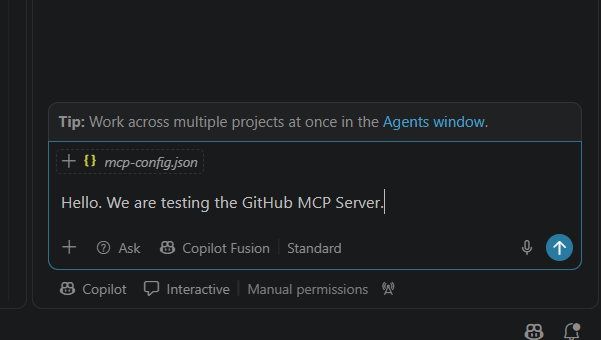

### Step 4: Verify the Installation

Navigate to **Customizations → MCP Servers**, locate **github-mcp-server**, and make sure the server is enabled.

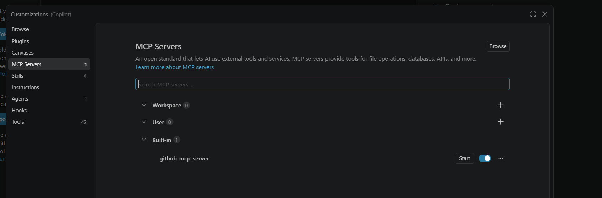

> **Note:** A Personal Access Token (PAT), custom authorization headers, and manual JSON configuration are not required for this introductory practice.

---

## Part 2: Activate MCP and Explore the Tools

**Estimated time: 7 minutes**

### Step 1: Start a Copilot Chat Session

Open **GitHub Copilot Chat**, start a new session, and use the Copilot **Agent** functionality. Send the following message:

> Hello. We are testing the GitHub MCP Server.

This initializes the Copilot session before testing the MCP Server.

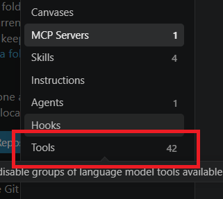

### Step 2: Verify the MCP Server

1. Return to **Customizations → MCP Servers**.
2. Locate **github-mcp-server**.
3. If necessary, start the server.

When the server is already running, Visual Studio Code may display **Stop Server** instead of **Start**. This indicates that the MCP Server is active.

### Step 3: Explore the Available MCP Tools

Navigate to **Customizations → Tools**, expand **github-mcp-server**, and review the available GitHub tools. Participants may see capabilities related to:

- Repository contents
- Commits
- Branches
- Issues
- Pull requests
- GitHub Actions

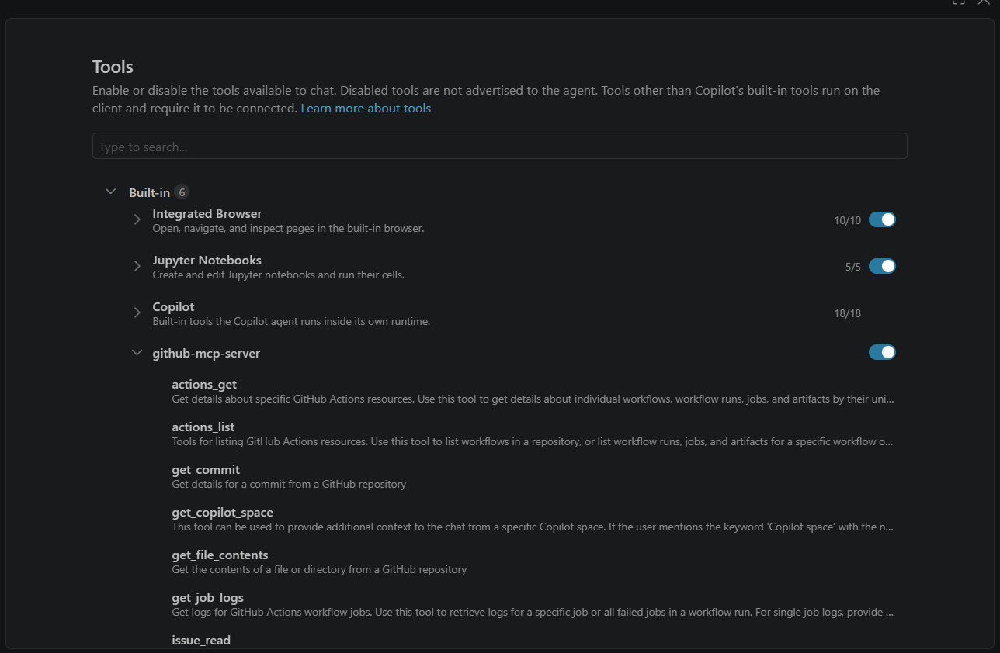

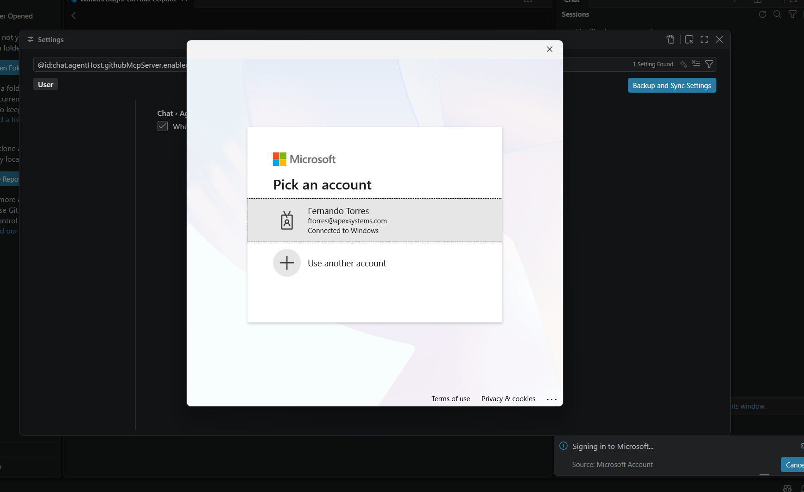

### Troubleshooting

If the MCP Server does not start, follow the Visual Studio Code instructions to refresh the GitHub/Copilot session using the sign-in process. After resolving the sign-in issue, return to **Customizations → Tools** and verify that the **github-mcp-server** tools are listed.

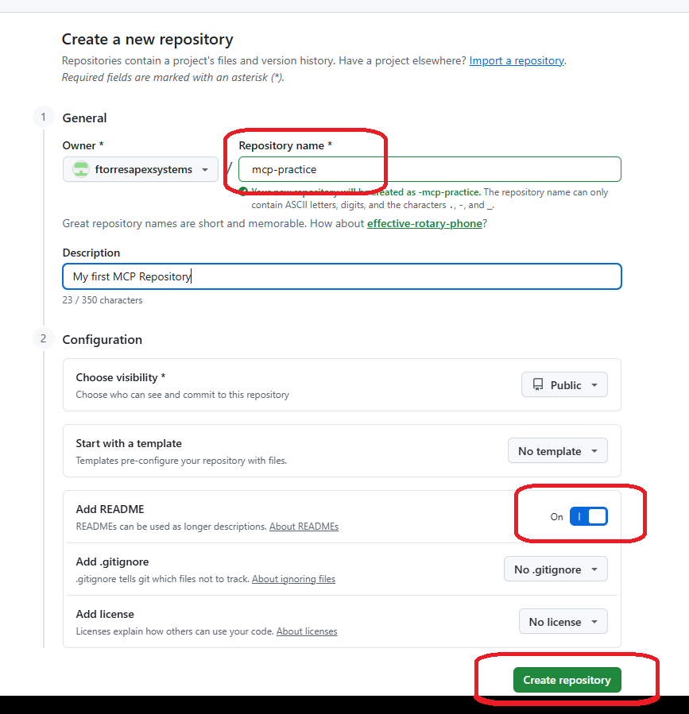

### Checkpoint 1

Before continuing, the Navigators must verify:

- [ ] GitHub MCP Server is installed.
- [ ] github-mcp-server is enabled.
- [ ] github-mcp-server is running.
- [ ] GitHub MCP tools appear under Tools.

If all four conditions are met, the MCP setup is complete. Otherwise, review the **Troubleshooting** section or ask the mentor for help.

---

## Part 3: Put MCP to Work

**Estimated time: 10 minutes**

### Step 1: Create a Practice Repository

Open GitHub and create a repository named **mcp-practice** with the following configuration:

- **Visibility:** Public
- **Initialize repository:** Add a README file

> **Note:** If the repository name is already in use under the account, use a variation such as `mcp-practice-your-full-name`.

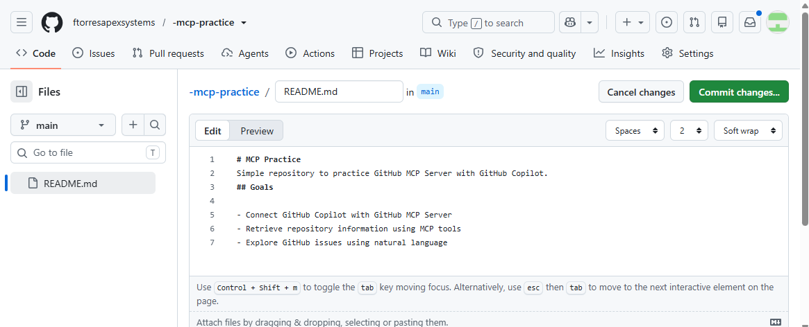

### Step 2: Add Simple Repository Content

Open `README.md`, edit the file, and add:

```markdown
# MCP Practice

Simple repository to practice GitHub MCP Server with GitHub Copilot.

## Goals

- Connect GitHub Copilot with GitHub MCP Server
- Retrieve repository information using MCP tools
- Explore GitHub issues using natural language
```

Commit the changes.

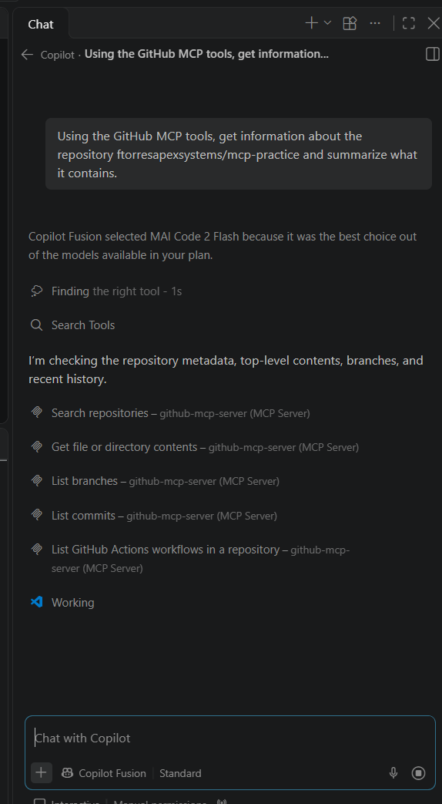

### Step 3: Ask Copilot About the Repository

Return to **GitHub Copilot Chat** in Visual Studio Code. Identify the repository using the format **GitHub username/repository name**. For example: `johnsmith/mcp-practice`.

Then ask Copilot:

> Using the GitHub MCP tools, get information about the repository johnsmith/mcp-practice and summarize what it contains.

Replace `johnsmith` with the GitHub username used to create the repository. If a different repository name was used, replace `mcp-practice` as well. Observe how Copilot uses the GitHub MCP tools to retrieve the repository information.

> **Permission prompt:** If Copilot asks for permission one or more times, select **Allow Once** after reviewing the requested tool action.

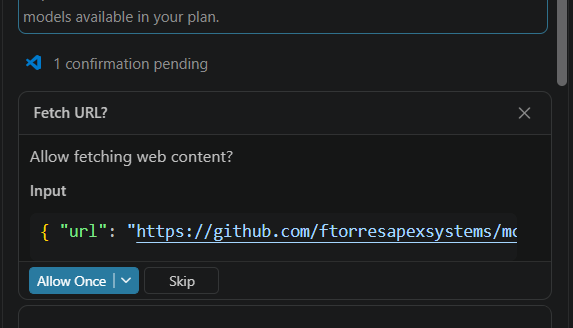

#### Expected Result

Copilot uses one or more tools identified as **github-mcp-server (MCP Server)** and returns a summary of the repository.

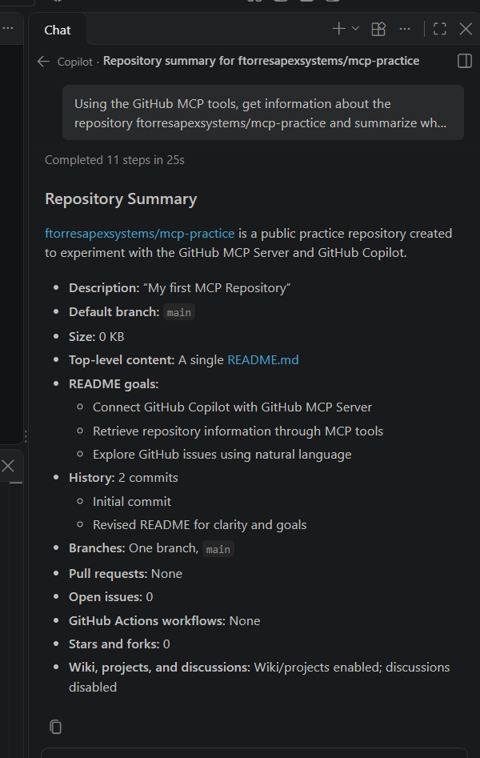

#### Troubleshooting

If Copilot responds with a message such as **“I couldn’t access GitHub MCP tools in this session,”** follow these steps:

1. Close the existing chat session.
2. Open a new chat using the **+** icon in the top menu.
3. Make sure the chat is using **Agent** mode. From the **+** menu at the bottom of the chat, select **Agent** instead of the default option.
4. Press **Ctrl + Shift + P** and open **Chat: Open Customizations**.
5. Open **Tools** and confirm that the Built-in **github-mcp-server** is signed in, running, and displaying its tools without errors.
6. Return to the new chat and enter the prompt again:

> Using the GitHub MCP tools, get information about the repository `<your-username>/<your-repository-name>` and summarize what it contains.

### Checkpoint 2

Verify:

- [ ] Copilot accepted the prompt.
- [ ] A GitHub MCP tool was used.
- [ ] Repository information was retrieved.
- [ ] Copilot summarized the repository.

At this point, the group has successfully demonstrated an end-to-end MCP interaction.

### Step 4: Create a GitHub Issue

Open the practice repository in GitHub and select **Issues → New issue**.

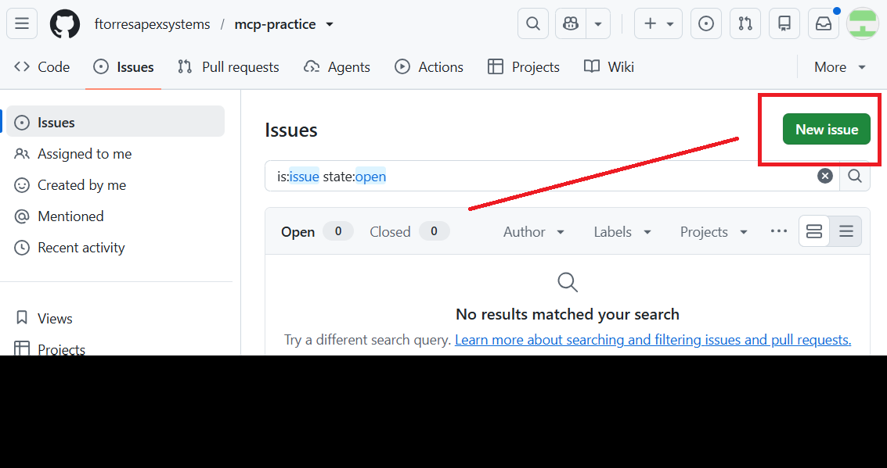

Complete the form using the following information:

- **Title:** `Add installation instructions by <YOUR FULL NAME>`
- **Description:** `Add installation instructions to the README file by <YOUR FULL NAME>.`

Replace `<YOUR FULL NAME>` with the Driver's full name, and select **Create**.

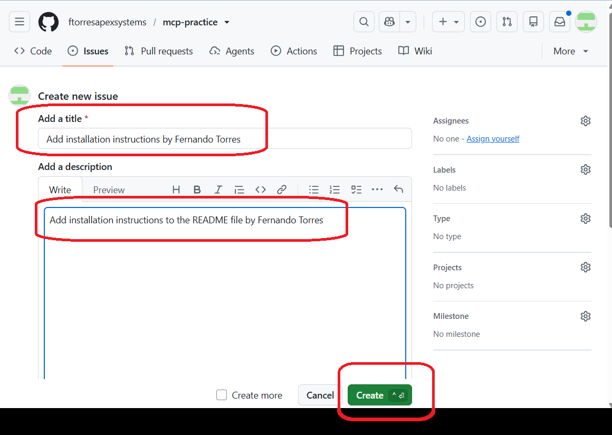

#### Expected Result

The issue appears as an open issue in the practice repository.

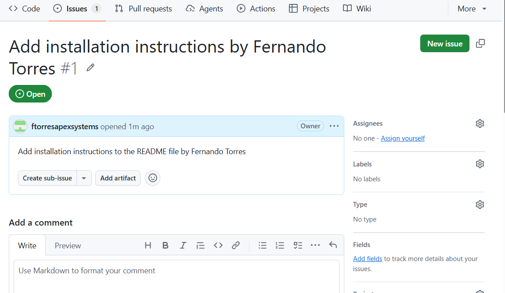

### Step 5: Ask Copilot to Retrieve the Issue

Before entering the prompt, make sure the current chat session is still using **Agent** mode.

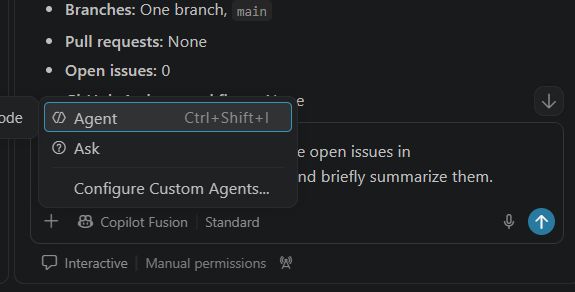

Return to **GitHub Copilot Chat** in Visual Studio Code. Confirm that Copilot Agent is active and the **github-mcp-server** tools are enabled. Then ask:

> Using the GitHub MCP tools, list the open issues in `<your-username>/<your-repository-name>` and briefly summarize them.

Replace `<your-username>/<your-repository-name>` with the actual repository identifier. Copilot should use a tool from **github-mcp-server** to retrieve the issue created in the previous step.

> **Important:** Verify that Copilot actually invokes a GitHub MCP tool. If Copilot retrieves the information using another method, the MCP test is not considered successful.

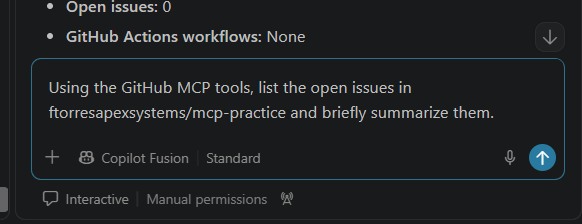

### Checkpoint 3

- [ ] Copilot used a github-mcp-server tool.
- [ ] Copilot found the open issue.
- [ ] Copilot summarized the issue correctly.

#### Expected Result

Copilot displays the MCP tool activity and returns the issue created by the group.

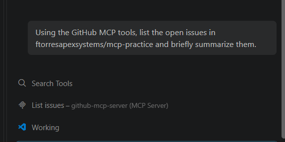

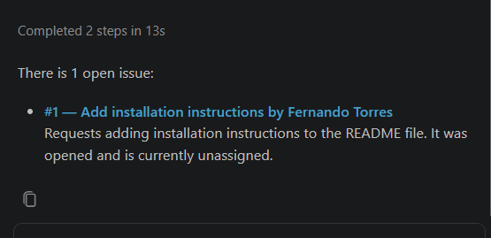

### Step 6: Review the MCP Tools Used

Review the tool activity shown in GitHub Copilot Chat and identify which GitHub MCP tool was used to complete the request. If needed, return to **Customizations → Tools → github-mcp-server** and compare it with the available tools.

The key observation is that Copilot is not accessing GitHub only through the local project. The Agent is using a capability exposed by the GitHub MCP Server to interact with GitHub.

#### Expected Result

The activity shows a tool such as **List issues - github-mcp-server (MCP Server)**.

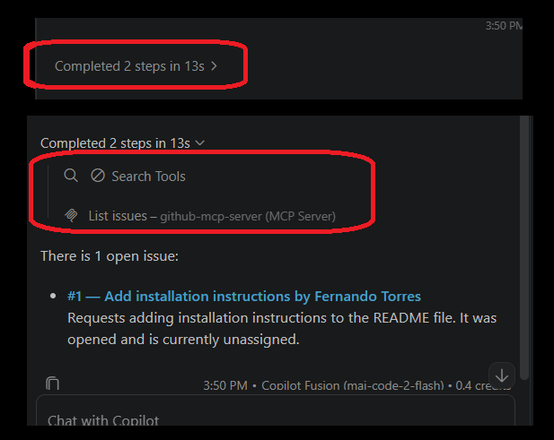

---

## Final Validation

Before completing the practice, verify:

- [ ] GitHub MCP Server is installed and running.
- [ ] GitHub MCP tools are enabled in the Copilot session.
- [ ] Copilot successfully retrieved repository information using MCP.
- [ ] A GitHub Issue was created.
- [ ] Copilot successfully retrieved the Issue using MCP.
- [ ] Participants identified at least one MCP tool used by Copilot.

## Practice Complete

The group has now implemented the following workflow:

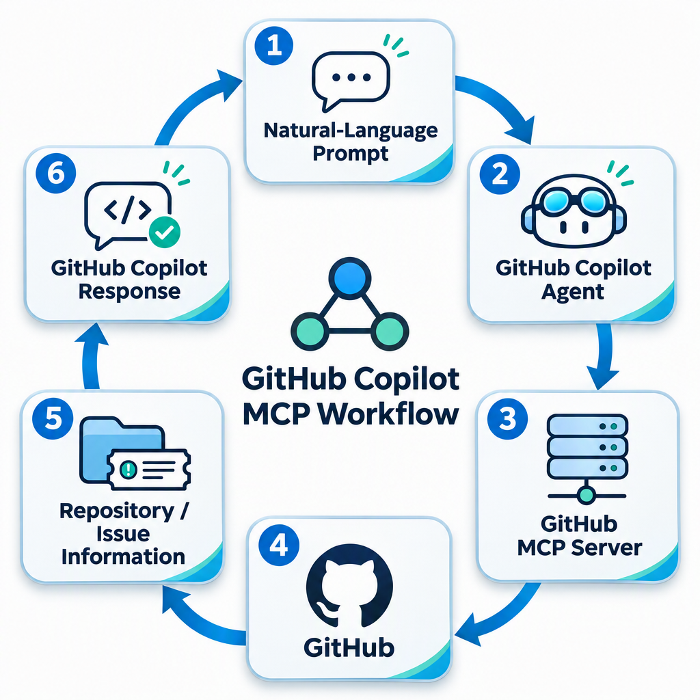

## Remember

MCP provides the standardized connection between the AI agent and external tools or services, while GitHub Copilot provides the conversational agent experience that decides how and when those tools should be used.

## Key Takeaways

- GitHub Copilot provides the AI Agent experience.
- MCP provides a standard way for the Agent to connect to external capabilities.
- GitHub MCP Server exposes GitHub capabilities as tools.
- The Agent can select and use these tools based on natural-language requests.
- MCP enables Copilot to interact with resources beyond the local editor context.
- A manual PAT configuration is not required for this introductory setup.

> **Final concept:** GitHub Copilot is the Agent, GitHub MCP Server provides the tools, and MCP provides the connection between them.

**Total estimated duration: approximately 30–35 minutes.**
